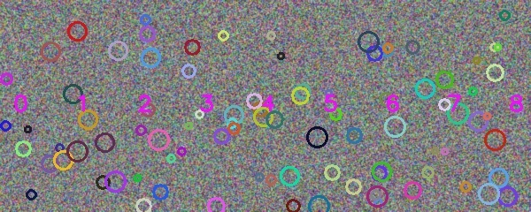

# 三图全景拼接实验

基于 OpenCV 的课程实验：SIFT 特征 → FLANN 近邻匹配与比值筛选 → RANSAC 单应矩阵 → 以中图为参考的三图透视变换 → 距离变换羽化融合 → 有效区域裁剪。保留四份原始实现，另提供独立路径适配入口和可重复生成的合成样例。

本组件属于 `vision-pattern-recognition-labs` 的传统视觉部分。SIFT、FLANN、RANSAC 和图像变换调用 OpenCV；这里展示流程组织、参数配置、融合/裁剪代码及实验分析，不声称从零实现这些基础算法。

## 运行

在本组件目录执行，建议使用独立 Python 环境：

```sh
python -m pip install -r requirements.txt
python run_panorama.py assets/synthetic/1.jpg assets/synthetic/2.jpg assets/synthetic/3.jpg --output-dir output
python -B tests/smoke.py
```

使用自己的三张图，将三个路径依次替换为左、中、右图；相邻图需有充分重叠。`--max-side 1600` 控制输入最长边。输出为 `result_crop.jpg` 与 `result_full.jpg`，同名文件会覆盖。原始 `CV_work1.py` 也可以从含 `1.jpg`、`2.jpg`、`3.jpg` 的工作目录直接运行，但不读取命令行参数。

程序输出的 `P` 是固定假设下的模型分数，未经真实正负图像对校准。`P≈1` 不能解释为拼接正确率接近 100%。

## 合成演示

三张 360×240 输入是同一 600×240 程序纹理的重叠裁片，不含真实地点、人物或第三方图片。下图为重新运行原始核心产生的裁剪结果。



生成器与检查放在 [tests/smoke.py](tests/smoke.py)，可运行 `python -B tests/smoke.py --write-demo assets/synthetic` 重新生成输入和演示结果。它会覆盖该演示目录下的五张图片。

## 文件与证据

| 内容 | 入口 |
|---|---|
| 最终归档核心，字节不变 | [CV_work1.py](CV_work1.py) |
| 公开路径适配入口 | [run_panorama.py](run_panorama.py) |
| 基础平均融合、另一种裁剪、注释学习版 | [历史版本说明](docs/PROVENANCE.md) |
| 架构与参数 | [ARCHITECTURE.md](docs/ARCHITECTURE.md) |
| 环境、输入和运行限制 | [RUNNING.md](docs/RUNNING.md) |
| 实际核验记录 | [VALIDATION.md](docs/VALIDATION.md) |
| 历史结果与公开边界 | [RESULTS.md](docs/RESULTS.md) |
| 来源哈希 | [source_manifest.json](docs/source_manifest.json) |
| 素材处理与第三方边界 | [MATERIALS.md](docs/MATERIALS.md)、[THIRD_PARTY_NOTICES.md](THIRD_PARTY_NOTICES.md) |

本次只完成小尺寸合成图 CPU 验证，没有重跑历史校园照片，也没有数据集性能、曝光差异、视差或复杂相机运动的系统测试。
